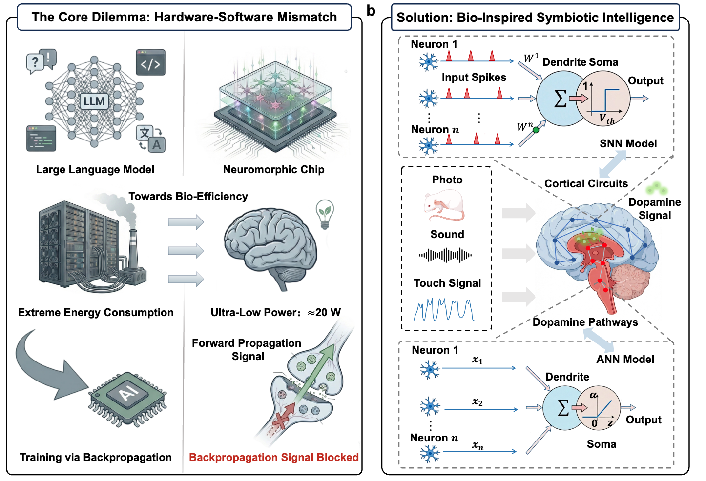

# SyNAX

**Brain-inspired Symbiotic Learning Unlocks Dynamic On-Chip Neuromorphic Intelligence (Under Review)**



## Software Experiments

This package contains the software experiment code requested for the first
SyNAX code release. It contains no datasets, pretrained weights, checkpoints,
experiment logs, hardware measurements, or credentials.

## Contents

| Directory | Experiments | Entry points |
| --- | --- | --- |
| `static_cifar10/` | CIFAR-10, ResNet-18 and ViT-Small/Base; executor GPU memory | `SyNAX_normalized_snn.py`, `eval_cifar10_snn_checkpoint.py`, `benchmark_gpu_memory.py` |
| `event_resnet18/` | CIFAR10-DVS and N-Caltech101, ResNet-18 | `synax_neuro.py`, `bp_sg_burst_resnet_event.py`, `bp_sg_sew_resnet_event.py`, `resnet18_event_online_baselines.py` |
| `scripts/` | Portable launch commands and dependency setup | See commands below |

The event comparison includes SyNAX, architecture-matched Burst SG-BPTT,
SEW-ResNet SG-BPTT, and the local-loss S-TLLR implementation. Speck hardware
experiments and illumination adaptation are outside this package.

## Environment

Use Python 3.10 on Linux and a CUDA-capable GPU. Create an isolated environment:

```bash
python3.10 -m venv .venv
source .venv/bin/activate
python -m pip install --upgrade pip
python -m pip install torch==2.3.0 torchvision==0.18.0 --index-url https://download.pytorch.org/whl/cu121
python -m pip install -r requirements.txt
python scripts/fetch_burst_dependency.py
```

`environment_observed.json` records the current server versions. The server uses
an NVIDIA PyTorch build; the installation command above uses the corresponding
public PyTorch release and is not a recovered historical environment lock.

The scripts set `PROTOCOL_BUFFERS_PYTHON_IMPLEMENTATION=python` for compatibility
with the older ONNX installation found in the server image. Weights & Biases
is disabled by default. Dataset preparation is described in `DATA.md`.

## CIFAR-10 training and SNN evaluation

Run one model and seed per invocation. Set `GPU` to an available physical GPU.
The script masks that device and uses `cuda:0` within the process.

```bash
GPU=0 bash scripts/run_static_cifar10.sh resnet18 42
GPU=0 bash scripts/run_static_cifar10.sh vit_small 42
GPU=0 bash scripts/run_static_cifar10.sh vit_base 42
```

The scripts train, then evaluate `best_ann.pt` using the appropriate converter.
ResNet uses Burst ANN2SNN; ViTs use the native project converter. To repeat
seeds 43--46, change the seed argument. The default is IID; for a Dirichlet
partition use `PARTITION=dir DIR_ALPHA=0.5`. `NODES` defaults to 50.

| Setting | ResNet-18 | ViT-Small / ViT-Base |
| --- | ---: | ---: |
| Communication rounds | 100 | 500 |
| Local epochs | 5 | 5 |
| Total clients | 50 | 50 |
| Client participation per round | 0.2 | 0.2 |
| SNN client fraction | 0.5 | 0.5 |
| Training batch size | 32 | 32 |
| ANN optimizer / learning rate | AdamW / 0.001 | AdamW / 0.001 |
| Executor coefficient | 0.1 | 0.1 |
| SNN timesteps | 8 | 8 |

The evaluation selects the saved best ANN checkpoint, rather than assuming the
last round or best evaluated SNN is the same endpoint. Historical static
results were generated across different code revisions; the missing original
`SNN_multiseed/results.tsv` has not been reconstructed here.

## Figure 2 event experiments

Prepare both frame caches and supply their parent directory through `DATA_ROOT`.

```bash
GPU=0 DATA_ROOT=/path/to/event_data bash scripts/run_event_resnet18.sh synax cifar10dvs 42
GPU=0 DATA_ROOT=/path/to/event_data bash scripts/run_event_resnet18.sh synax ncaltech101 42
GPU=0 DATA_ROOT=/path/to/event_data bash scripts/run_event_resnet18.sh burst_sgbptt cifar10dvs 42
GPU=0 DATA_ROOT=/path/to/event_data bash scripts/run_event_resnet18.sh sew_sgbptt ncaltech101 42
GPU=0 DATA_ROOT=/path/to/event_data bash scripts/run_event_resnet18.sh stllr_local cifar10dvs 42
```

Each method supports both datasets. SyNAX and SG-BPTT main curves use seeds
42--44; S-TLLR was extended to seeds 42--46. The common federation protocol is
six clients, full participation, 200 rounds, one local epoch, and SNN `T=8`.
Method-specific optimizers, augmentations, batch sizes, and normalizations are
explicit in the launcher. They are not all identical.

Event SyNAX uses AdamW with learning rate 0.001 and executor coefficient 0.005.
Burst and SEW SG-BPTT use SGD at 0.05. S-TLLR-local uses Adam at 0.001 with
stage-local classifiers and persistent client optimizer states.

## Figure 2j GPU memory benchmark

Use `benchmark_gpu_memory.py` for the standardized SG-BPTT/SyNAX executor
memory comparison. This is the only memory benchmark included in the package.

From the package root:

```bash
GPU=0 bash scripts/run_gpu_memory.sh
```

This runs ResNet-18 and ViT-Small/Base/Large with batch size 4, SNN `T=8`,
FP32, three repeats, and SGD at learning rate 0.05, momentum 0.9 and weight
decay 0.0005 for SG-BPTT. ResNet inputs are 32x32; ViT inputs are 224x224.
It uses synthetic inputs and needs no dataset or checkpoint. SyNAX measures
two forward probes with an in-memory perturbation direction, not ANN
orchestrator memory or a complete federated training round. Model conversion
occurs before peak statistics are reset. The reported metric includes all
process-local live CUDA tensors at that point and during the measured step.

CSV, summary CSV and metadata JSON are written under `results/memory/`.
The figure metric is `peak_allocated_gib` from
`torch.cuda.max_memory_allocated`, in GiB (bytes / 1024^3), not reserved
memory or `nvidia-smi` process memory. Large-model SG-BPTT may require an
80 GB GPU; an out-of-memory error is not a valid memory measurement.
For a smaller run, pass model names:

```bash
GPU=0 bash scripts/run_gpu_memory.sh resnet18 vit_small
```

## Third-party Code

ANN-to-SNN conversion uses [Burst ANN2SNN](https://github.com/bic-L/burst-ann2snn).
Run `python scripts/fetch_burst_dependency.py` to install the pinned version
with the supplied compatibility patches.

The [S-TLLR](https://github.com/mapolinario94/S-TLLR) baseline is included under
its MIT license. See [THIRD_PARTY.md](THIRD_PARTY.md) for references,
[SOURCE_MANIFEST.json](SOURCE_MANIFEST.json) for source hashes, and
[VALIDATION.md](VALIDATION.md) for validation details.

## Contact

For questions or issues, please open an issue on this repository.
